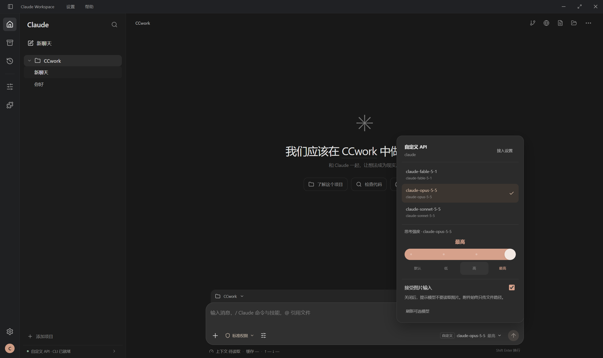
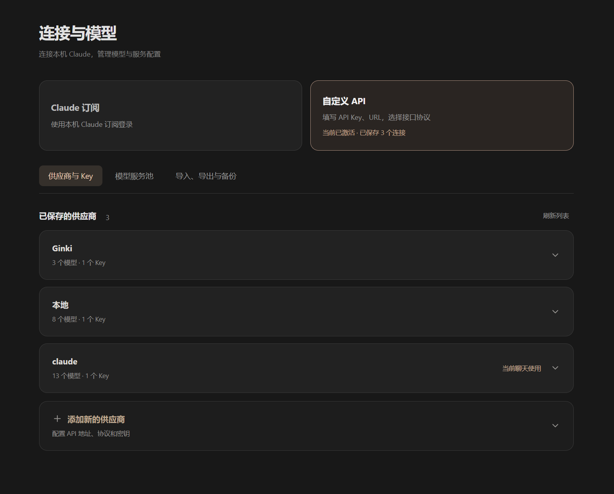
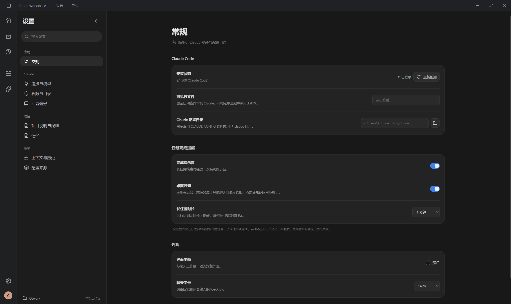
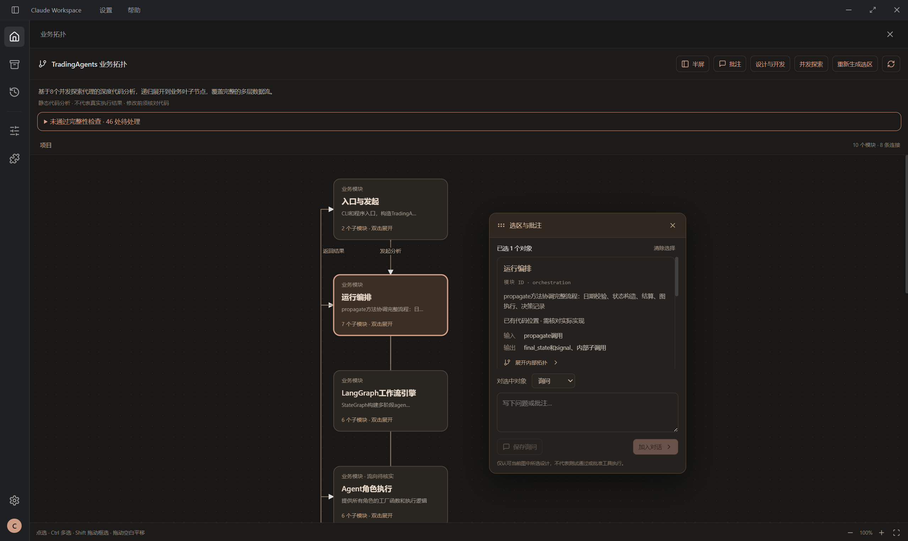

# Claude Workspace

为 Claude Code CLI 提供接近 Codex 体验的 Windows 图形化界面，保留大部分原生能力，让命令、项目配置和模型接入都能在界面中操作。

内置小型 API 网关，将不同协议及部分不规范的上游响应统一适配为 Claude CLI 可用的本地接口，通过重试、备用线路和多 Key 调度提升调用稳定性。

## 主要功能

- **图形化工作区**：对标 Codex 的使用体验，提供项目侧栏、流式聊天、工具审批、子代理记录、分支与重新生成。
- **原生命令与快捷输入**：支持 `/` 命令与 Skills、`@` 引用项目文件、`#` 快速记忆；常用命令附中文用途，部分交互命令通过图形界面操作。
- **可视化配置 `.claude`**：在界面中调整权限、CLAUDE.md、规则、记忆、Hooks、插件与 MCP，管理个人及项目配置。
- **内置 API 网关**：适配 Anthropic Messages、OpenAI Chat Completions 和 Responses，统一请求、流式响应与工具调用格式。
- **容灾与重试**：上游限流、临时故障或超时时自动重试，并在兼容线路间切换；聊天中显示等待原因和重试进度。
- **一个模型，多条线路**：多个供应商共同服务一个模型，支持不同模型 ID 手动映射、多 Key 加权轮询、供应商权重和会话粘性路由。
- **开发辅助**：代码变更审阅、内置浏览器与网页元素批注，以及可逐层展开、批注和讨论的业务拓扑。

## 下载安装

1. 安装 [Claude Code CLI](https://code.claude.com/docs/en/setup)。
2. 前往 [下载页面](https://github.com/Xiaobai123977/claude-workspace/releases/latest)，选择 **Setup 安装版**（推荐）或便携版。
3. 打开应用，使用本机 Claude 登录，或填写自己的 API 地址和 Key。

安装版不需要另装 Node.js。遇到环境问题，可下载同页的 **Environment-Check.zip**，解压后双击 `Check-Environment.cmd`，缺少工具时会询问是否安装。

## 界面演示

**聊天与模型选择**



**供应商与模型管理**



<details>
<summary>查看更多：常规设置与业务拓扑</summary>





</details>

## 从源码运行

需要 Git、Node.js 22.12+ 和 Claude Code CLI。

```powershell
git clone https://github.com/Xiaobai123977/claude-workspace.git
cd claude-workspace
npm ci
npm start
```

也可双击 `Run-Claude.cmd`，按提示检查环境并启动。打包 Windows EXE：`npm run pack:win`。

## 更多说明

[命令与快捷输入](docs/claude-command-interaction.md) · [供应商路由](docs/model-routing.md) · [网关重试](docs/gateway-retry.md) · [业务拓扑](docs/business-topology.md) · [详细使用](docs/usage-reference.md) · [环境检查](docs/windows-environment.md)

## 许可证

[MIT](LICENSE)。Claude Code CLI 和第三方依赖遵循各自许可与服务条款。
